[~ Home](../README.md)

# Use Cases & Examples

This section gives real-world scenarios that show how the functions work by navigating through the app as a user would do under certain circumstances, then taking screenshots of each operation with a before and after for comparison. 

When a user navigates to the site, it immediately takes you to the interface of our app as shown in the screenshot below: 

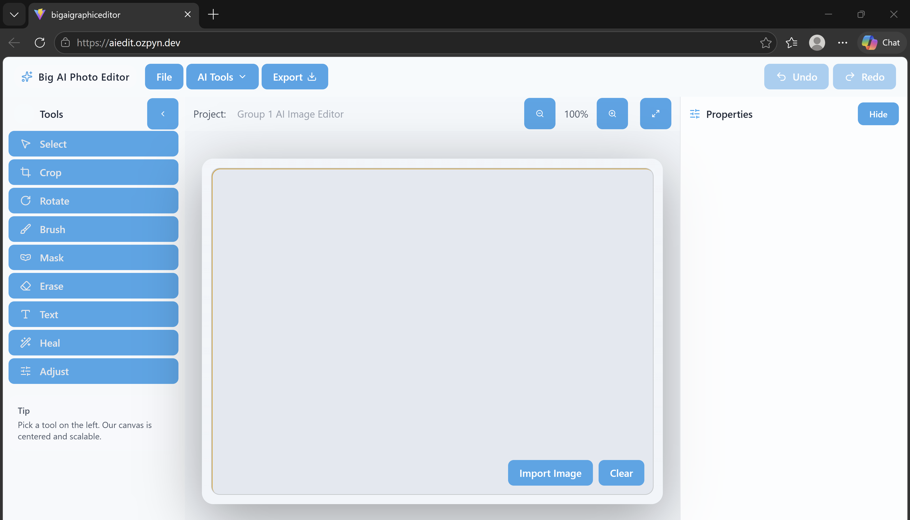

And then the first thing the user has to do is to import (upload) the image they want to edit by clicking the import image button or the file button in the menu bar. Clicking one of these buttons opens a file picker, that allows you to navigate into your laptop and pick an image of your choice as shown in the screenshot below 

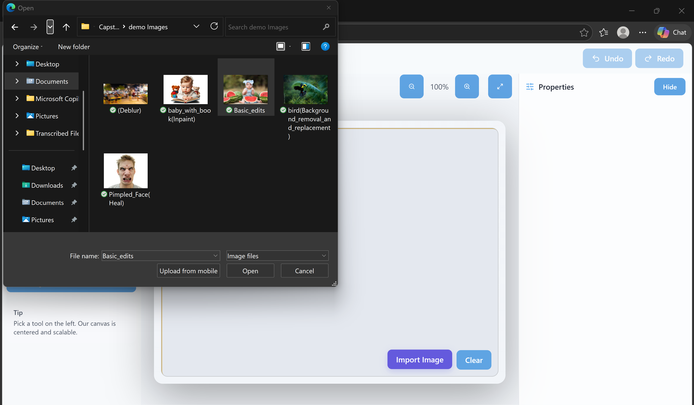

Then after choosing, you click open then your image is immediately displayed into your canvas and then you can start doing your edits using any function of your choice either from the toolbox (at the left) which is all about the non AI-edits or using the AI Tools (in the menu bar) that contains a dropdown list of AI-features supported by our app.

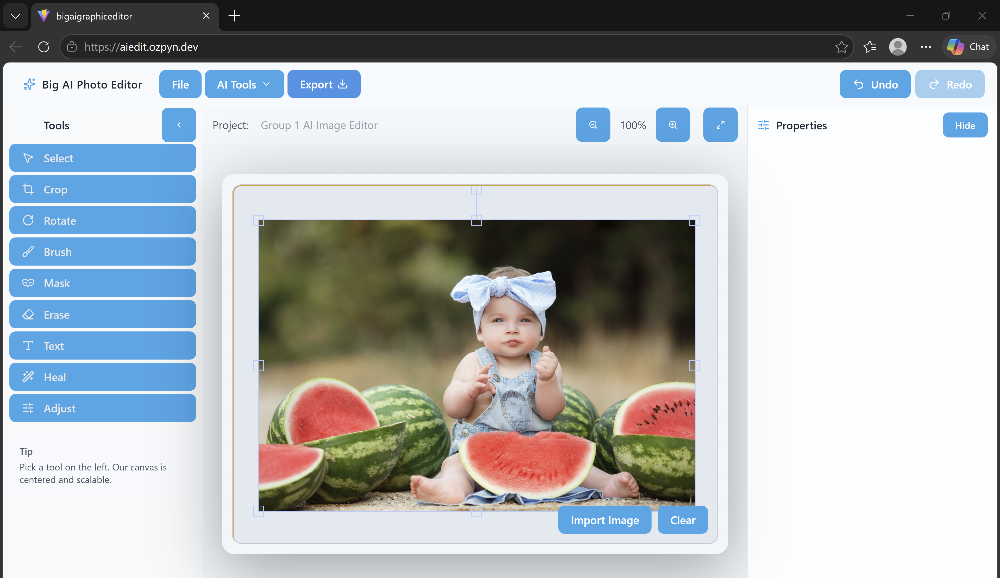

I. Basic Edit Functions
Let first do the basic edits (Select, Crop, Rotate, Brush, Mask, Erase, Text, Heal and Adjust)

i. Select Tool
This is the default tool for our application. The moment you import your image, select tool becomes the active tool. This tool does not do much, it all about allowing you to move or resize your image in the canvas.
In the screenshot below I used it to resize my image and the move it to the top right of the canvas:

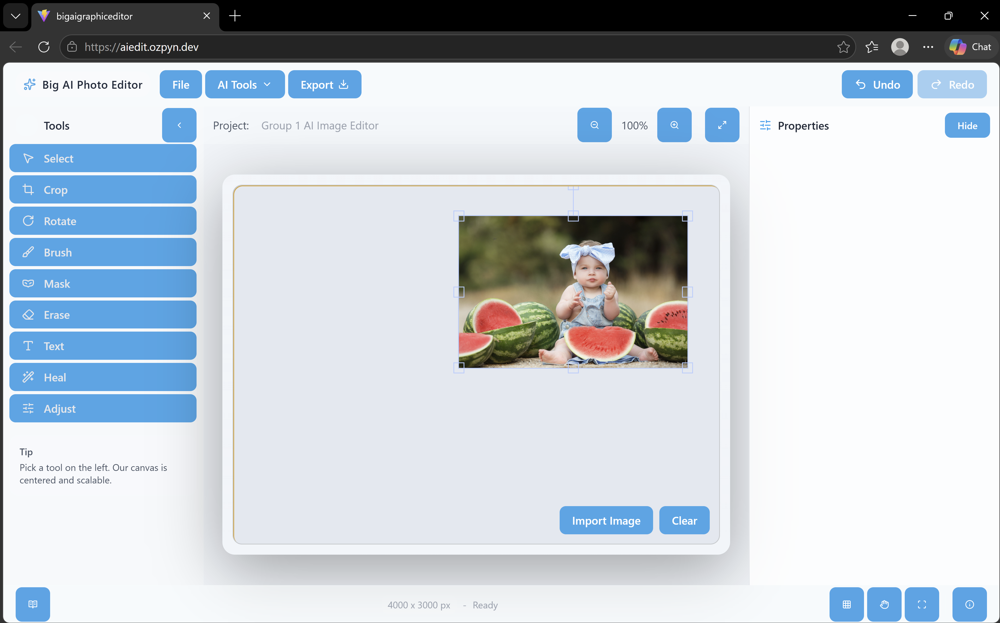

ii. Crop Tool
When you select the Crop tool, a rectangular selection box appears on the image. You can resize and position this rectangle to cover the portion of the image you want to keep..

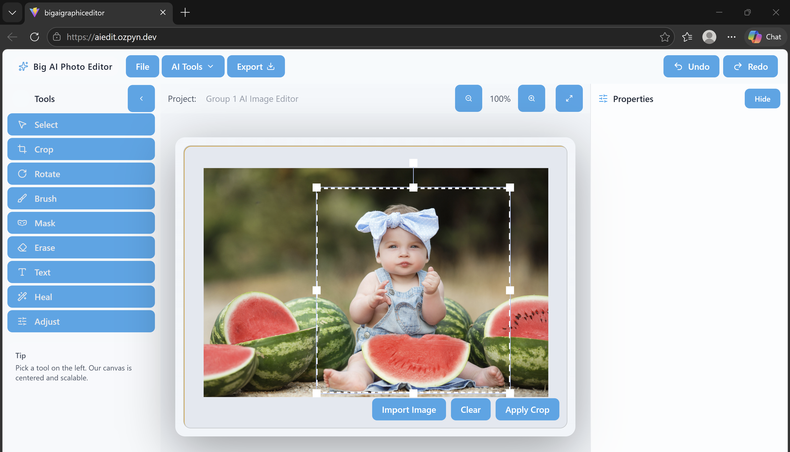

After adjusting it, click the Apply Crop button to remove everything outside the selected area

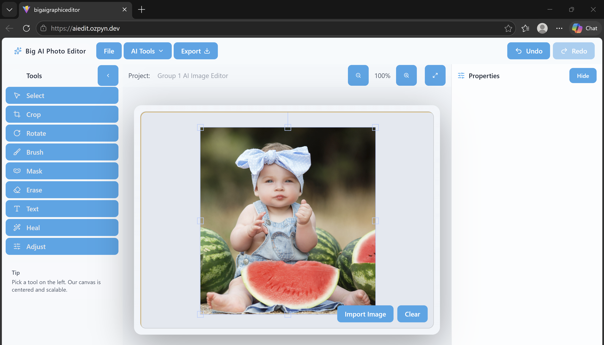

iii. Rotate Tool
Clicking the Rotate tool allows you to rotate your image either to the left or right. Once selected, rotation controls appear, including buttons for rotating left, rotating right, and resetting the image to its original orientation if needed. 
For the screenshot, I rotated my image to the right. 

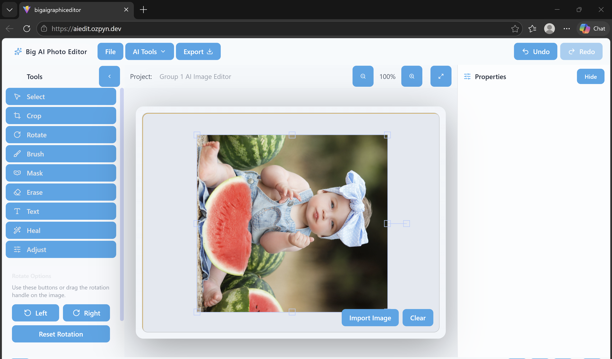

iii. Rotate Tool
Clicking the Rotate tool allows you to rotate your image either to the left or right. Once selected, rotation controls appear, including buttons for rotating left, rotating right, and resetting the image to its original orientation if needed. 
For the screenshot, I rotated my image to the right. 

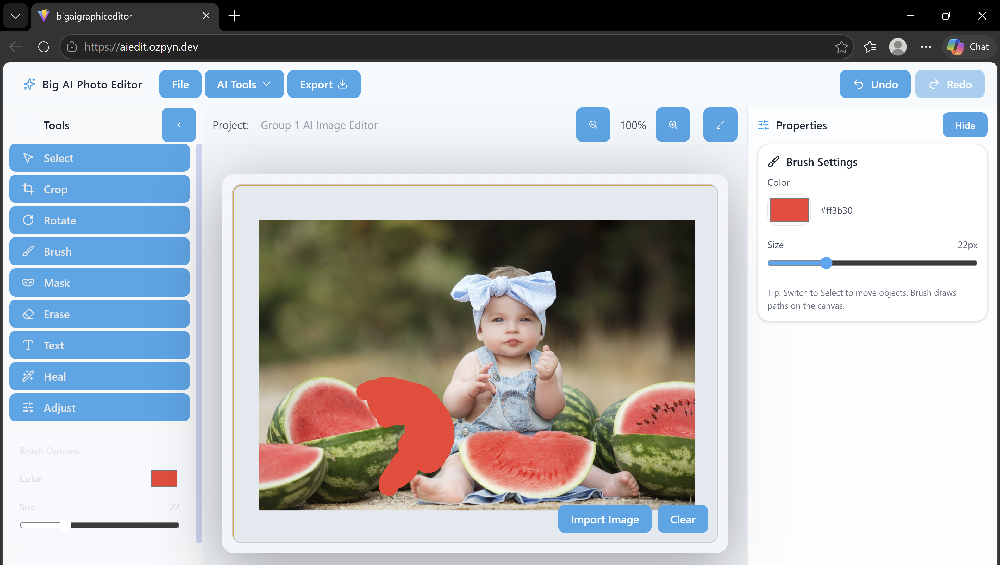

iv. Brush Tool
When you click the Brush tool, the brush settings appear in the Properties panel where you can choose the color and size of the brush. After selecting your preferred settings, you can draw directly on the image by clicking and dragging the mouse over the canvas. This allows you to highlight or manually edit specific parts of the image.

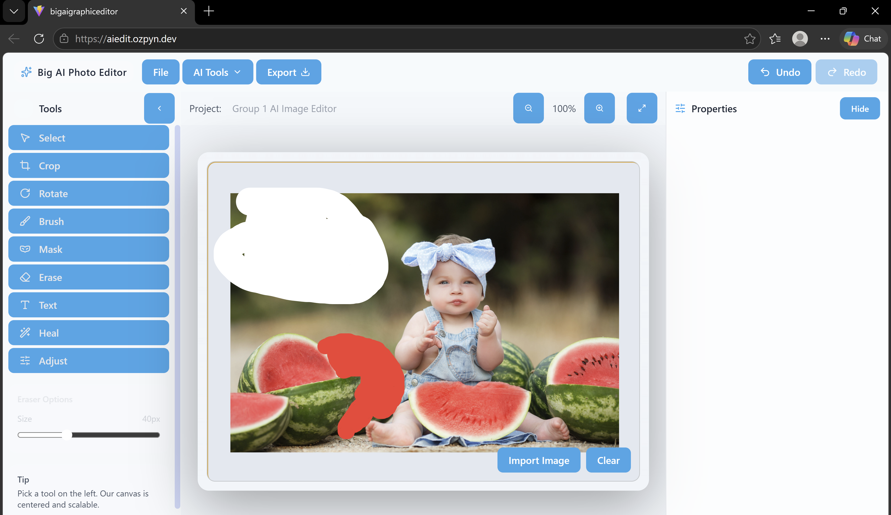

v. Erase Tool
Clicking the Erase tool allows you to remove parts of the image by brushing over them. The erased areas appear as white (or transparent depending on implementation). You can adjust the brush size from the Properties panel to control how much area is erased. 
    
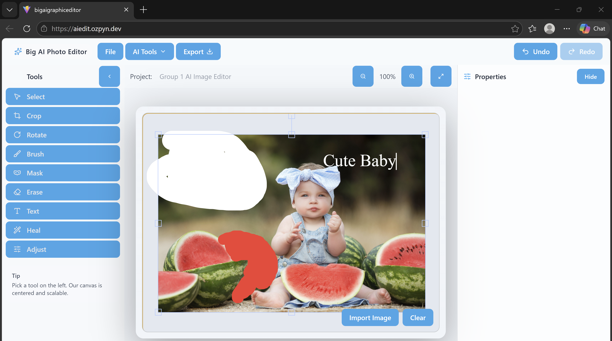

vi. Text Tool
After clicking the Text tool, click on the exact location in the image where you want to place your text. This action creates a text box where you can type your desired content. You can then adjust its position and size as needed. 

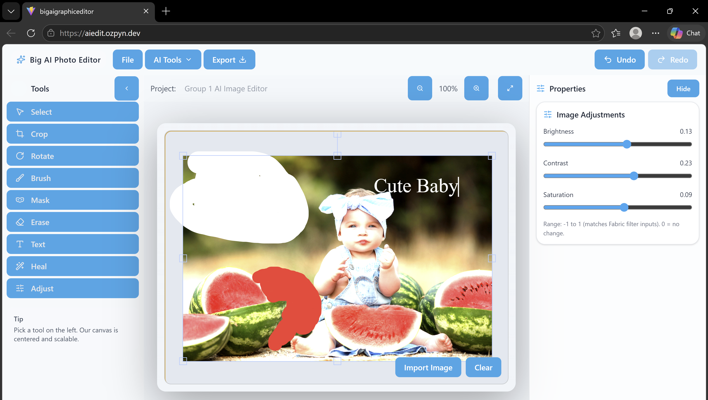

vii. Adjust
Clicking the Adjust tool opens sliders in the Properties panel for Brightness, Contrast, and Saturation. You can move these sliders to enhance the appearance of your image based on your preferences. 
In the screenshot below I adjusted the brightness, contrast and saturation as shown

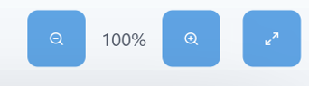

viii. Zoom in, Zoom out and Fit Button

Clicking the Zoom in button increases the size of the image by zooming it, while the zoom out  button reduces the size of the image , whereas the fit button fits the image in the canvas.
    
ix. Heal Button
The Heal tool is used to remove unwanted objects or imperfections from an image. First, set the brush size and flow in the Properties panel. Then, hold the Alt key and click on a clean area near the object you want to remove to sample pixels. After that, move your cursor over the unwanted area (e.g., a pimple) and paint over it. 

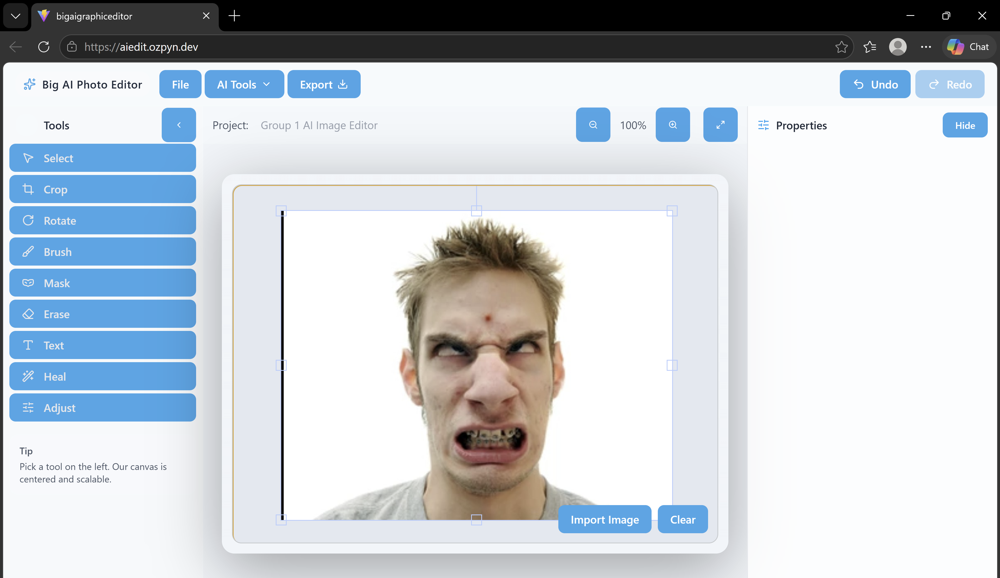

The tool blends the sampled pixels to produce a natural-looking result. 
The screenshot below shows the result

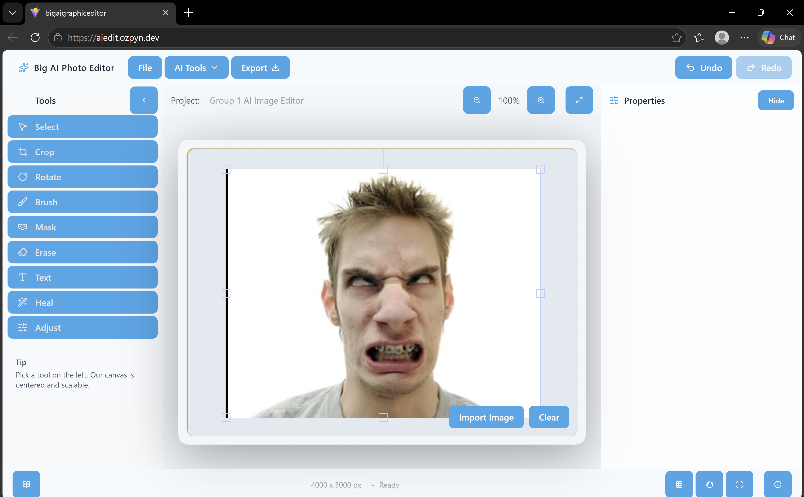

II. AI Edit Functions
This section explains the AI-based editing features. To access them, click the AI Tools button in the top menu bar. This opens a dropdown menu containing all AI-powered features available in the application.

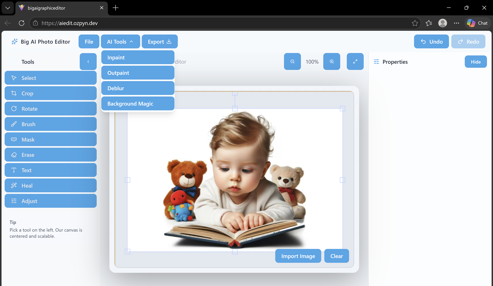    

i. Inpaint
Inpaint allows the user to replace an object in the image. First, use the Mask tool to highlight the area you want to replace. Then, select Inpaint from the AI Tools menu. A prompt box will appear where you describe what should replace the masked area. After entering the prompt, click Apply Inpaint and wait for processing.
Making the area then giving a prompt

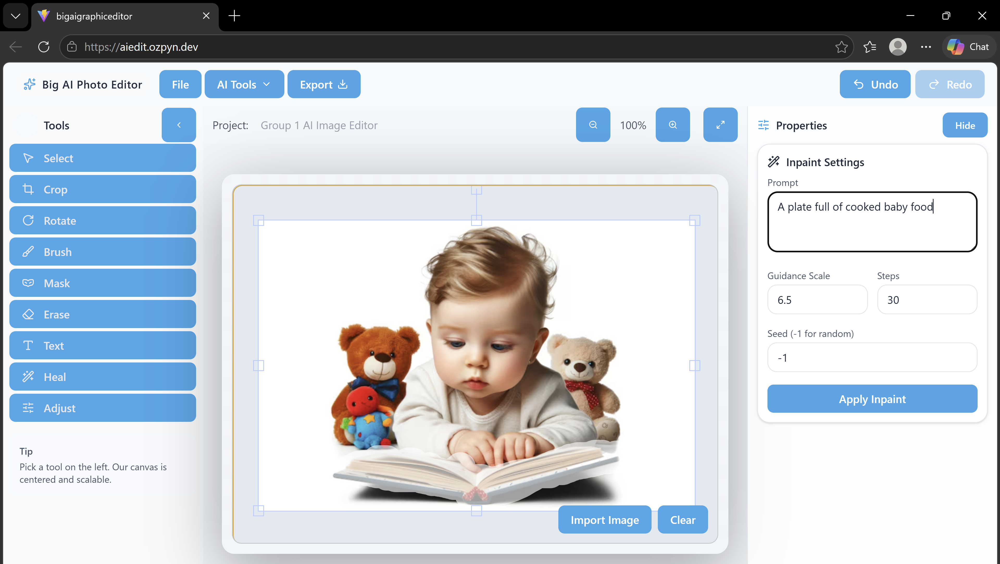    

In our screenshot, we used “A plate full of baby food” as a prompt. Meaning we want the book to be replaced by the plate food. Then click the “Apply Inpaint” button. Give it some time to process, after processing, the updated image will be displayed

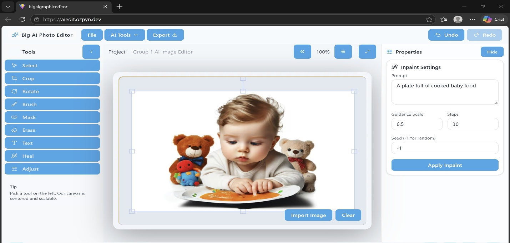    

ii. Background Removal

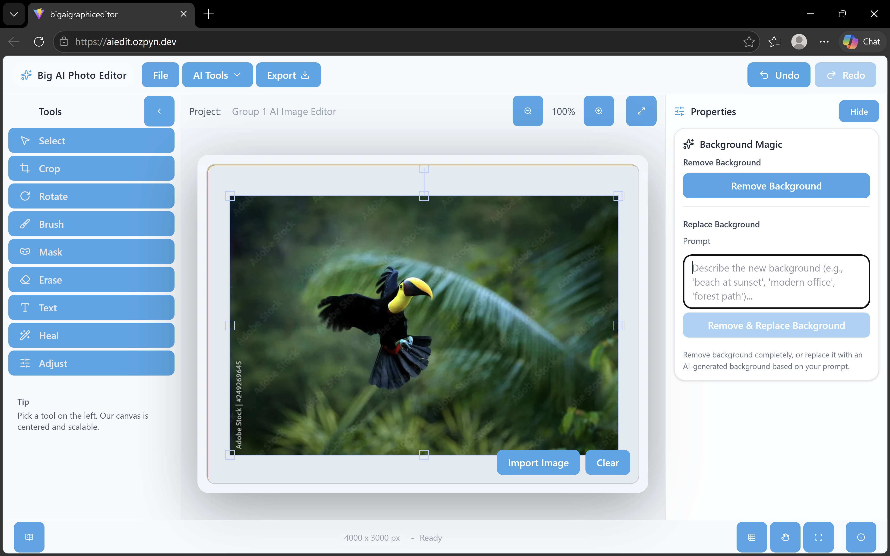    

Select the background magic in the dropdown menu that appears when you click AI tools. For background removal you don’t need to give a prompt, you just click the “Remove Background button” at the right in the properties panel.
Background removal replaces the image background by a transparent background as shown in the screenshot

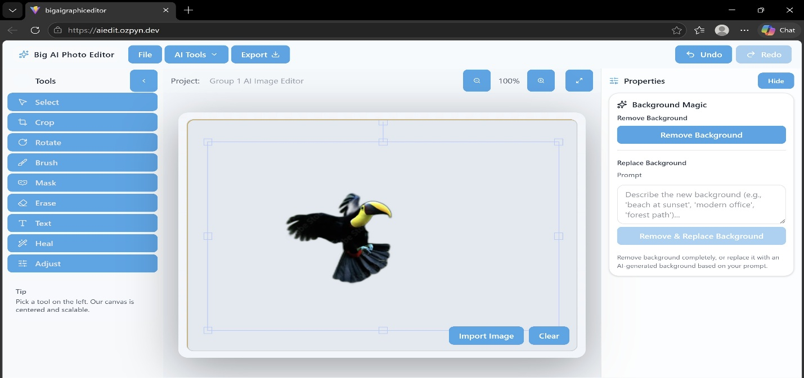    

iii. Background Replacement
Background replacement allows a user to replace the image background by a background of their choice by allowing them to give a prompt of what they want the background to be.

    

In our screenshot we used “blue sky” as a prompt. Meaning we want the background to be replaced by a blue sky

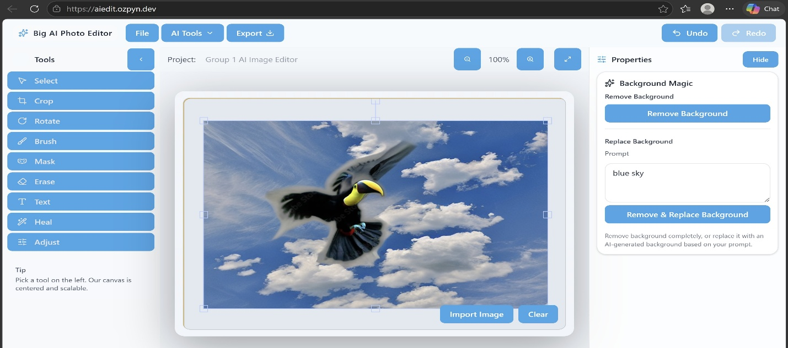    

iv. Deblur Button
The Deblur tool is used to enhance blurry images. To use it, select Deblur from the AI Tools menu, then click the Apply Deblur button. Providing a prompt is optional but may improve results. The system processes the image and produces a clearer version.

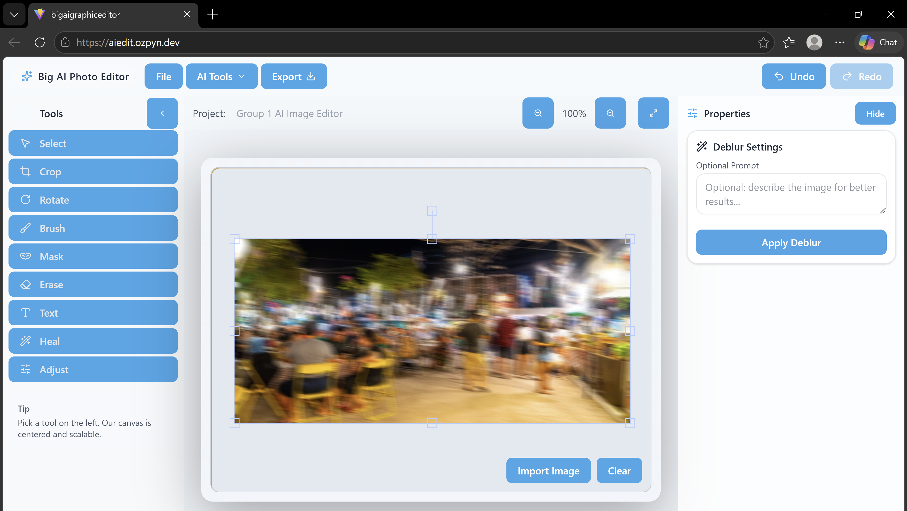    

Deblur allows a user to turn a blurry image into a clear version of it.

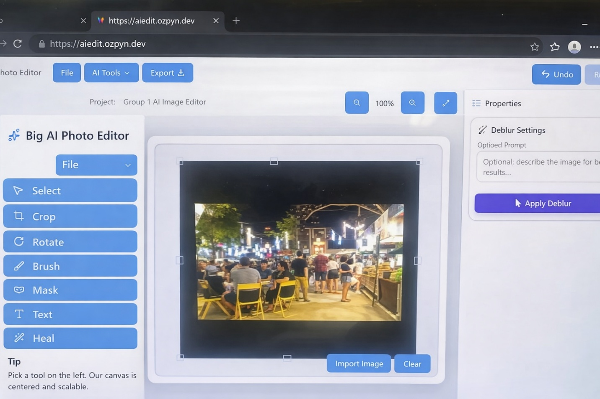    

Undo and Redo Button
The Undo and Redo buttons allow users to navigate through their editing history. Undo reverts the image to a previous state, while Redo restores changes that were undone.
A user may do a background replacement and not like the result, just by clicking the undo button they are able to restore the previous state of their image. Whereas for redo, it allows them to restore the previously undone edits.

Export
After completing your edits (Basic and AI edits), you can download the final image by clicking the Export button in the menu bar. The image is exported in PNG format.

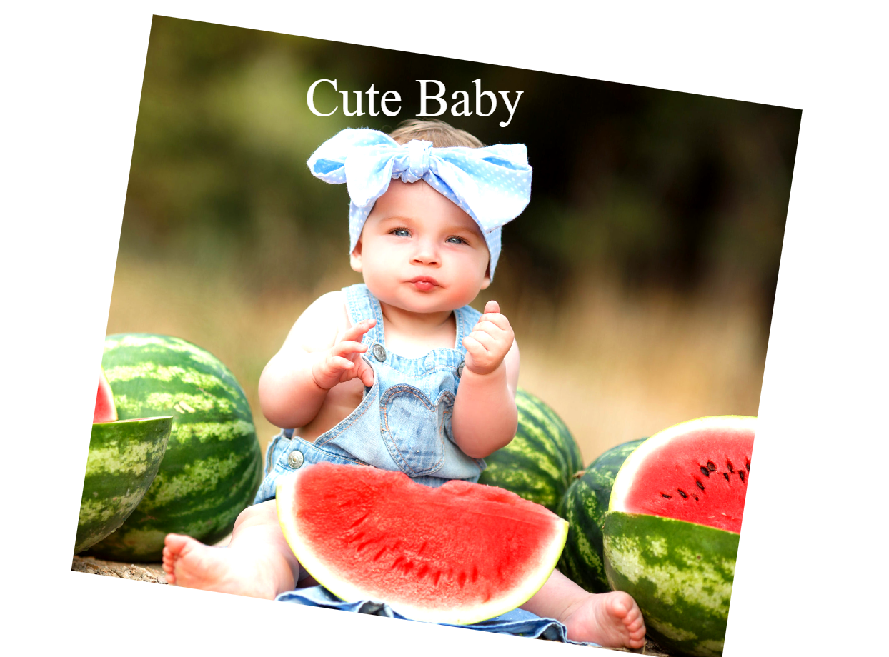    